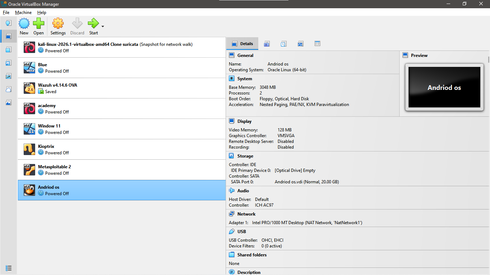
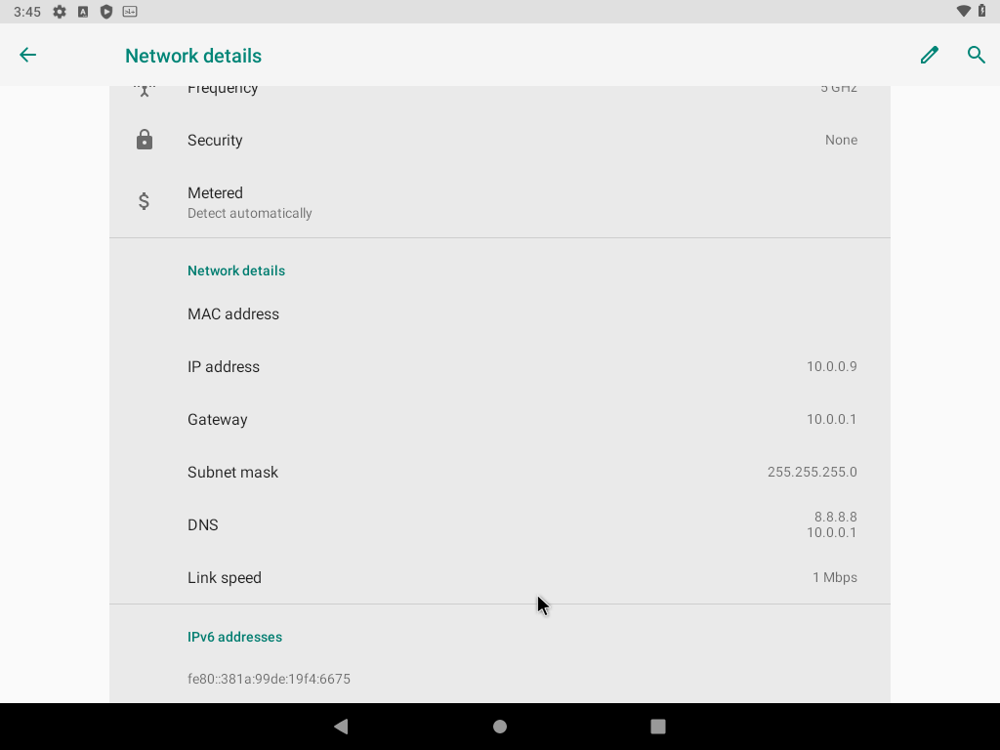
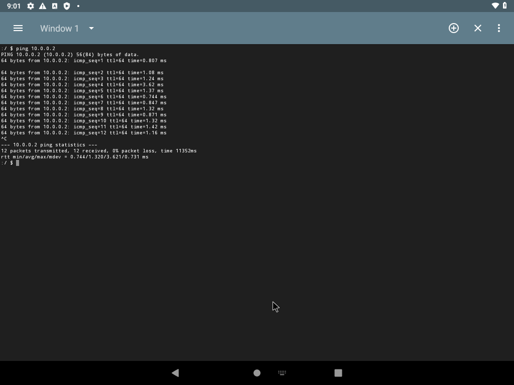
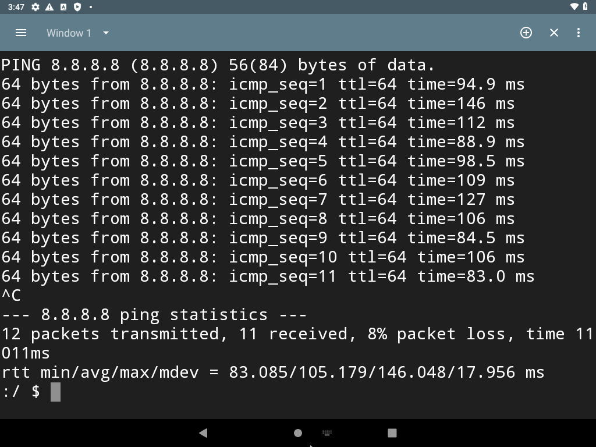
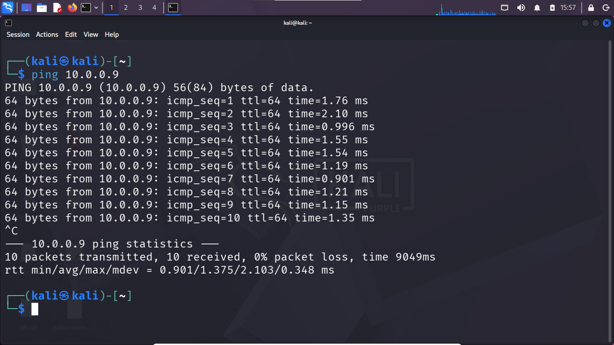

# Networkwalks Week 1: Android-x86 VirtualBox Lab

**Author:** Faisol Daud  
**Program:** Networkwalks Cybersecurity Internship · Week 1 Extra Project

## Overview

I configured Android-x86 9.0 as a virtual machine in Oracle VirtualBox and connected it to a Kali Linux VM through a shared NAT Network. I assigned static IPv4 addresses and tested communication between the two virtual machines, along with outbound IP connectivity from Android-x86.

This project demonstrates basic virtual networking, static IP configuration, and connectivity verification in a controlled lab environment.

## Lab configuration

| Component | Configuration |
|---|---|
| Hypervisor | Oracle VirtualBox |
| Android guest | Android-x86 9.0 · `10.0.0.9/24` |
| Kali Linux guest | Kali Linux · `10.0.0.2/24` |
| Network | VirtualBox NAT Network |
| Gateway | `10.0.0.1` |
| DNS server | `8.8.8.8` |

Both virtual machines are connected to the same NAT Network, allowing them to communicate with one another and access external networks through the configured gateway.

## Network topology

```text
                 Internet
                    |
          VirtualBox NAT Network
               10.0.0.0/24
                /        \\
           Kali Linux   Android-x86
           10.0.0.2      10.0.0.9
```

## Connectivity verification

I tested connectivity in both directions between the virtual machines and checked Android-x86's outbound IP connectivity.

| Test | Command | Purpose |
|---|---|---|
| Android-x86 → Kali Linux | `ping 10.0.0.2` | Verify connectivity from Android-x86 to Kali |
| Kali Linux → Android-x86 | `ping 10.0.0.9` | Verify connectivity in the reverse direction |
| Android-x86 → external IP | `ping 8.8.8.8` | Check outbound IP connectivity |

These checks help verify network reachability. A failed ping alone does not necessarily prove that a destination is unreachable, because ICMP traffic may be filtered.

## Evidence screenshots

The following screenshots document the virtual machine, network settings, and connectivity tests.

### Android-x86 VM in VirtualBox



### Android-x86 network configuration



### Android-x86 ping to Kali Linux



### Android-x86 outbound connectivity test



### Kali Linux ping to Android-x86



## Key takeaways

Through this project, I practised how to:

- Configure Android-x86 as a VirtualBox guest.
- Connect two virtual machines to a shared NAT Network.
- Apply static IPv4 network settings.
- Test guest-to-guest connectivity in both directions.
- Check outbound IP connectivity and document the results with screenshots.

## References

- [Android-x86](https://www.android-x86.org/)
- [Android-x86 9.0 releases](https://sourceforge.net/projects/android-x86/files/Release%209.0/)
- [Oracle VirtualBox](https://www.virtualbox.org/)
- [Networkwalks sample lab repository](https://github.com/waqaskarimccie/NETWORKWALKS-B082-WK1-PM1-CYBERSECURITY-LAB-SETUP-SAMPLE)

## Acknowledgements

I would like to thank Sir Waqas Karim (CCIE) and the Networkwalks team for their guidance on the project.
